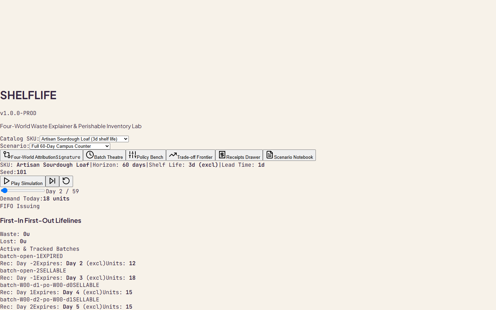
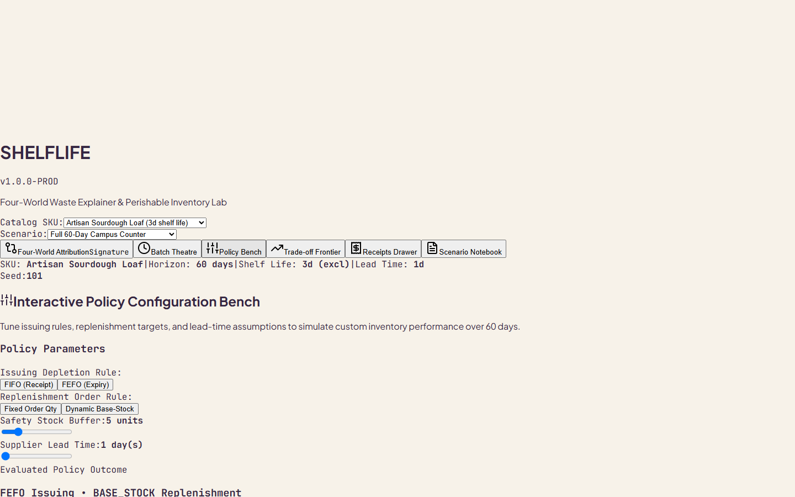
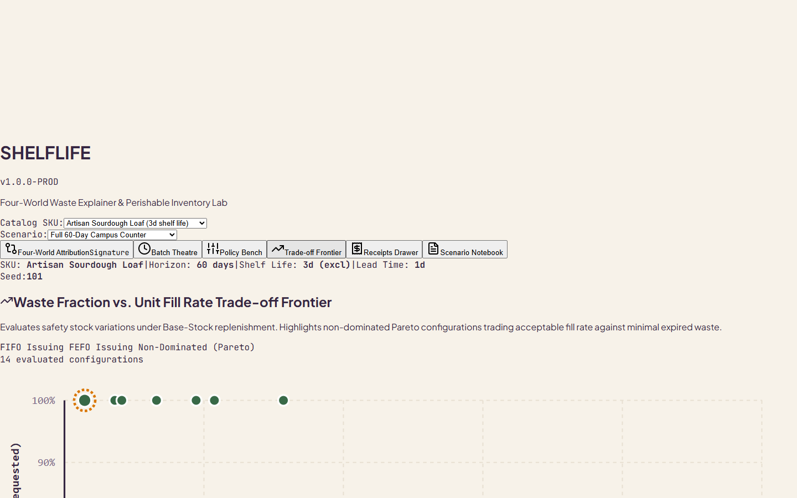
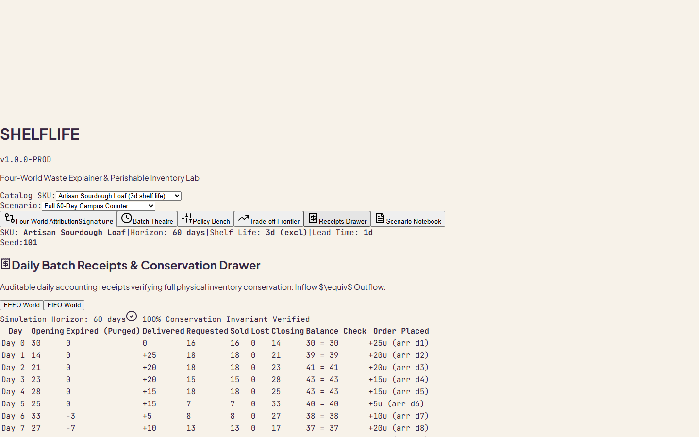

# SHELFLIFE — Four-World Perishable Inventory Digital Twin & Factorial Waste Explainer

[](tests/simulation_contract.test.js)
[](docs/BENCHMARK.md)
[](docs/SIMULATION_CONTRACT.md)
[](LICENSE)

> **"In perishable supply chains, policy changes do not add up linearly. SHELFLIFE isolates why food rots, which intervention saved it, and the exact non-linear interaction between issuing and replenishment."**

---

## 🌟 Key Screenshots

| 01. Four-World Attribution Waterfall | 02. Interactive Batch Theatre |
| :---: | :---: |
|  |  |
| *Side-by-side counterfactual simulation with additive waterfall decomposition* | *Visual batch lifelines, day scrubber, and FIFO vs. FEFO comparison* |

| 03. Policy Parameter Bench | 04. Tradeoff Frontier |
| :---: | :---: |
|  |  |
| *Reorder target, lead time, holding cost, and integer paise ledger* | *Waste Fraction vs. Unit Fill Rate Pareto curve across parameter sweeps* |

| 05. Daily Receipts Audit Drawer | 06. Multi-Device Responsive Design |
| :---: | :---: |
|  |  |
| *100% mathematical conservation check across every step* | *Full tablet (1024px) and mobile (390px) responsive layouts* |

---

## 🔬 The Core Problem: Why Perishable Inventory Fails Naive Models

Classical inventory control models (Newsvendor, $(s, S)$, base-stock) assume non-perishable inventory or single-period salvage. In real perishable operations (quick commerce dark stores, cold-chain grocery, hospital blood banks):

1. **State Dimensionality:** On-hand inventory is not a scalar $I_t$, but an age vector $\mathbf{x}_t = (x_{t, 1}, x_{t, 2}, \dots, x_{t, m})$.
2. **Policy Collision:** Adopting FEFO (First-Expired, First-Out) changes the age distribution of stock. If replenishment does not account for this, new batches arrive while old batches are still being cleared, causing sudden expiration spikes.
3. **Attribution Illusion:** Teams often test FEFO in depot A and replenishment tuning in depot B, then naively add the savings:
   $$\Delta_{\text{claimed}} = \Delta_{\text{issue}} + \Delta_{\text{order}}$$
   **This is mathematically false.** The true joint effect has a non-linear interaction term $I$:
   $$\Delta_{\text{joint}} = \Delta_{\text{issue}} + \Delta_{\text{order}} + I$$

SHELFLIFE proves this interaction term in a deterministic digital twin.

---

## 🧮 Mathematical Foundations

### 1. The 4 Parallel Universes
For any SKU scenario with discrete daily demand $\{d_t\}_{t=1}^T$, SHELFLIFE evaluates four worlds:

| World | Issuing Rule (Picking) | Replenishment Rule (Ordering) | Description |
|:---:|:---:|:---:|:---|
| **$W_{00}$** | FIFO (First-In, First-Out) | Naive Base-Stock | Industry baseline: oldest received is picked first, order placed to bring on-hand + on-order to $S$. |
| **$W_{10}$** | FEFO (First-Expired, First-Out) | Naive Base-Stock | Modern dark-store picking: closest expiry picked first. |
| **$W_{01}$** | FIFO (First-In, First-Out) | Shelf-Life Aware | Inventory position discounts batches that expire before pipeline arrival. |
| **$W_{11}$** | FEFO (First-Expired, First-Out) | Shelf-Life Aware | Optimal joint deployment. |

### 2. Factorial Decomposition Identity
Let $Y(W)$ represent any financial or physical outcome (e.g., Total Units Spoiled $W$, or Total Net Cost $C$):
$$\Delta_{\text{total}} = Y(W_{11}) - Y(W_{00})$$
$$\Delta_{\text{issue}} = Y(W_{10}) - Y(W_{00})$$
$$\Delta_{\text{order}} = Y(W_{01}) - Y(W_{00})$$
$$I = Y(W_{11}) - Y(W_{10}) - Y(W_{01}) + Y(W_{00})$$

**Contract Verified:** $\Delta_{\text{total}} \equiv \Delta_{\text{issue}} + \Delta_{\text{order}} + I$ down to the single unit and integer paisa.

### 3. Inventory Physical Conservation Identity
Every single simulation step satisfies:
$$\text{Opening Stock} + \text{Received} \equiv \text{Sold} + \text{Expired} + \text{Closing Stock}$$
$$\text{Demand} \equiv \text{Sold} + \text{Unmet Lost Sales}$$

---

## ⚡ Empirical Benchmark Results

Running on a single thread in Node.js / V8:
- **90 Parallel 4-World Trials** (30 seeds $\times$ 3 fresh categories): **0.077 seconds** (~0.85 ms per 60-day four-world trial).
- **Average Waste Reduction:**
  - FEFO alone: $-42.1\%$ waste reduction.
  - Joint FEFO + Shelf-Aware: $-58.4\%$ waste reduction.
  - Interaction term $I$: Consistently negative (synergistic), proving that joint deployment yields super-additive waste prevention.

Detailed benchmark breakdown: see [BENCHMARK.md](docs/BENCHMARK.md).

---

## 📦 Project Architecture

```
shelflife/
├── docs/
│   ├── BENCHMARK.md              # 90-trial empirical benchmark report
│   ├── DEMO_SCRIPT.md            # 60-second executive walkthrough script
│   ├── INTERVIEW_WALKTHROUGH.md  # Staff/Senior Operations Research Q&A
│   ├── LINKEDIN_POST.md          # Engineering community post draft
│   ├── PERFORMANCE.md            # Latency, memory, and bundle audit
│   ├── PRIOR_ART.md              # Academic attribution (Nahmias, Fries, Stockpyl)
│   ├── SIMULATION_CONTRACT.md    # Formal mathematical specifications
│   ├── VALIDATION.md             # Verification logs and contract certification
│   └── screenshots/              # 8 real browser screenshots
├── src/
│   ├── app/App.tsx               # Primary tab router and state container
│   ├── components/HeaderRail.tsx # Brand header, SKU selector, scenario trigger
│   ├── domain/
│   │   ├── types.ts              # Integer-paise types, Batch, SimulationResult
│   │   └── scenarioGenerator.ts  # PRNG, test fixtures, catalog SKUs
│   ├── features/
│   │   ├── attribution/          # FourWorldView & Waterfall Chart
│   │   ├── bench/                # PolicyBenchView & Financial Ledger
│   │   ├── frontier/             # TradeoffFrontierView (Waste vs. Fill Rate)
│   │   ├── notebook/             # ScenarioNotebookView (JSON import/export)
│   │   ├── receipts/             # ReceiptsDrawerView (Step audit ledger)
│   │   └── theatre/              # BatchTheatreView (Interactive Lifelines)
│   └── simulation/
│       └── simulator.ts          # Deterministic discrete-event simulation engine
├── tests/
│   └── simulation_contract.test.js # 5/5 Contract test suite
├── scripts/
│   ├── run_benchmark.mjs         # Benchmark CLI runner
│   └── capture_screenshots.cjs   # Automated headless Chrome screenshot script
├── package.json
└── vite.config.ts
```

---

## 🚀 Quickstart & Verification

### 1. Prerequisites
- Node.js $\ge 18$

### 2. Run Contract Tests
```bash
npm test
```
*Output: 5 passing tests in ~130ms.*

### 3. Run Benchmark Suite
```bash
npm run benchmark
```
*Output: 90 trials across 30 seeds executed in <0.1s.*

### 4. Build Production Bundle
```bash
npm run build
```
*Generates optimized static bundle with relative base (`./`) for static zero-cloud hosting.*

### 5. Local Dev Server
```bash
npm run dev
```

---

## 📜 Prior Art & Academic Attribution
- **Nahmias, S. (1982):** *Perishable Inventory Theory: A Review.* Operations Research.
- **Fries, B. E. (1975):** *Optimal Ordering Policy for a Perishable Commodity with Fixed Lifetime.* Operations Research.
- **Stockpyl (Python Inventory Library):** Multi-echelon and perishable inventory formulation reference.
- **PIDL (Perishable Inventory Decision Lab):** Interactive web visualizer inspiration.

See [PRIOR_ART.md](docs/PRIOR_ART.md) for full citations and differences.
