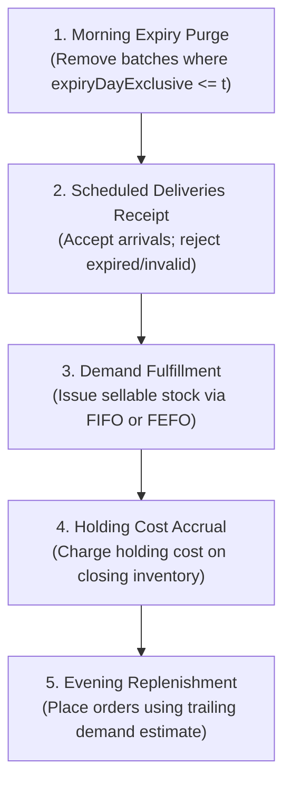

# SHELFLIFE — Simulation & Policy Attribution Contract

**Specification Version:** 1.0.0-PROD  
**Author:** Shobal Sabu (BCA Data Analytics Portfolio)  
**Date:** 20 October 2026  

---

## 1. Domain Entities & Integer Unit Arithmetic

All monetary values are represented as non-negative 64-bit integers in **paise** (1 Rupee = 100 paise) to eliminate floating-point rounding errors. All inventory counts are non-negative integers.

### 1.1 Data Schema
```typescript
interface SKU {
  readonly id: string;
  readonly name: string;
  readonly unitCostPaise: number;          // Procurement cost per unit
  readonly sellingPricePaise: number;       // Sales revenue per fulfilled unit
  readonly holdingCostPaisePerDay: number; // Storage cost per closing unit/day
  readonly disposalCostPaise: number;      // Handling penalty per expired unit
  readonly lostUnitPenaltyPaise: number;   // Hypothetical planning penalty per lost unit
}

interface Batch {
  readonly id: string;
  readonly skuId: string;
  readonly receivedDay: number;            // Simulation day arrived
  readonly expiryDayExclusive: number;     // Day at which batch becomes unsellable
  readonly initialUnits: number;           // Quantity received
  remainingUnits: number;                  // Current sellable units
}

interface PurchaseOrder {
  readonly id: string;
  readonly placedDay: number;
  readonly arrivalDay: number;             // placedDay + leadTimeDays
  readonly quantity: number;
  readonly shelfLifeOnArrivalDays: number; // Expiry = arrivalDay + shelfLifeOnArrivalDays
}

interface DailyDemand {
  readonly day: number;
  readonly skuId: string;
  readonly requestedUnits: number;
}
```

### 1.2 Expiry Convention (Exclusive Day)
- Expiry is strictly **exclusive**: a batch with `expiryDayExclusive = 3` can be sold on day 0, day 1, and day 2.
- On the morning of day 3, at Step 1, all remaining units of this batch expire and move to waste.

---

## 2. Daily Simulation Step Sequence

Each simulation day $t \in [0, H)$ executes five sequential, non-overlapping phases:



1. **Morning Expiry Purge**:
   - Inspect all batches in stock. Any batch with $\text{expiryDayExclusive} \le t$ is purged.
   - Removed units are recorded as `expiredWasteUnits`.
2. **Scheduled Delivery Ingestion**:
   - Any purchase order with $\text{arrivalDay} = t$ arrives.
   - If $\text{shelfLifeOnArrivalDays} \le 0$ or already expired, units are rejected to `rejectedReceipts`.
   - Otherwise, a new `Batch` is created and added to the sellable pool.
3. **Demand Observation & Fulfillment**:
   - Exogenous requested demand $D_t$ is observed.
   - Units are issued from sellable batches according to the chosen policy:
     - **FIFO**: Sort batches ascending by `receivedDay` (break ties by `batchId`).
     - **FEFO**: Sort batches ascending by `expiryDayExclusive` (break ties by `batchId`).
   - If total sellable stock $I_{\text{avail}} < D_t$:
     - Fulfilled units = $I_{\text{avail}}$.
     - Lost demand units = $D_t - I_{\text{avail}}$. Lost demand is unbackordered.
4. **Holding Cost Accrual**:
   - Accrue holding cost on the closing sellable stock: $\sum_{\text{batches}} \text{remainingUnits} \times \text{holdingCostPaisePerDay}$.
5. **Replenishment Ordering (No Future Peeking)**:
   - Base-stock target $S$ evaluates observed demand strictly up to day $t$:
     $$\hat{D} = \frac{1}{\min(t+1, 7)} \sum_{k=\max(0, t-6)}^t D_k$$
   - Pipeline inventory = $\text{OnHand} + \text{OnOrder}$.
   - Order quantity $Q = \max(0, \lceil (S - \text{Pipeline}) / \text{packSize} \rceil \times \text{packSize})$.

---

## 3. Strict Conservation Invariants

At the end of every simulation day $t$ and at the conclusion of horizon $H$, the following balance identities must hold with **zero discrepancy**:

### 3.1 Inventory Conservation Identity
$$\text{Opening Stock} + \sum \text{Accepted Deliveries} \equiv \sum \text{Sold Units} + \sum \text{Expired Waste} + \text{Closing Sellable Stock}$$

### 3.2 Demand Balance Identity
$$\sum \text{Requested Units} \equiv \sum \text{Fulfilled Units} + \sum \text{Lost Demand Units}$$

---

## 4. Hand-Checkable Distinguishing Fixture

The simulator must strictly reproduce the following hand-checkable canonical example:
- **Day 0 Opening Batches**:
  - Batch A: $5\text{ units}$, received day $-2$, expiring on day $4$ ($\text{expiryDayExclusive} = 4$).
  - Batch B: $5\text{ units}$, received day $-1$, expiring on day $1$ ($\text{expiryDayExclusive} = 1$).
- **Deliveries**: None.
- **Demand**: Day 0 = $5\text{ units}$, Day 1 = $5\text{ units}$.

### Trace under FIFO:
- **Day 0**: FIFO sorts by `receivedDay`: Batch A (day -2) is issued first. All 5 units of Batch A are sold. Batch B remains in stock ($5\text{ units}$).
- **Day 1**: Morning expiry check sees Batch B ($\text{expiry} = 1 \le 1$). Batch B is purged to waste ($5\text{ units}$). Demand of 5 arrives, but stock is 0.
- **FIFO Result**: **$5\text{ Sold}$**, **$5\text{ Wasted}$**, **$5\text{ Lost Demand}$**.

### Trace under FEFO:
- **Day 0**: FEFO sorts by `expiryDayExclusive`: Batch B (day 1) is issued first. All 5 units of Batch B are sold. Batch A remains in stock ($5\text{ units}$).
- **Day 1**: Morning expiry check sees Batch A ($\text{expiry} = 4 > 1$). Batch A is sellable. Demand of 5 arrives and is fulfilled from Batch A.
- **FEFO Result**: **$10\text{ Sold}$**, **$0\text{ Wasted}$**, **$0\text{ Lost Demand}$**.

---

## 5. Four-World Factorial Policy Attribution

To isolate issuing choices from ordering choices, SHELFLIFE executes identical exogenous demand and delivery schedules across four parallel worlds:

| World Code | Issuing Policy | Ordering Policy | Waste Metric |
| :---: | :---: | :---: | :---: |
| **$W_{00}$** | FIFO (Baseline) | Fixed Order (Baseline) | $W_{00}$ |
| **$W_{10}$** | **FEFO** (Changed) | Fixed Order (Baseline) | $W_{10}$ |
| **$W_{01}$** | FIFO (Baseline) | **Base-Stock** (Changed) | $W_{01}$ |
| **$W_{11}$** | **FEFO** (Changed) | **Base-Stock** (Changed) | $W_{11}$ |

### 5.1 Factorial Decomposition Identities
1. **Issuing Policy Contrast** (at baseline ordering):
   $$\Delta_{\text{issue}} = W_{10} - W_{00}$$
2. **Ordering Policy Contrast** (at baseline issuing):
   $$\Delta_{\text{order}} = W_{01} - W_{00}$$
3. **Policy Interaction Effect**:
   $$I = W_{11} - W_{10} - W_{01} + W_{00}$$
4. **Joint Total Difference**:
   $$\Delta_{\text{joint}} = W_{11} - W_{00}$$

### 5.2 Mandatory Attribution Balance
$$\Delta_{\text{issue}} + \Delta_{\text{order}} + I \equiv \Delta_{\text{joint}}$$

When the interaction term $I \ne 0$, assigning the entire waste reduction to a single policy is demonstrably misleading. SHELFLIFE renders this explicit factorial bridge.
